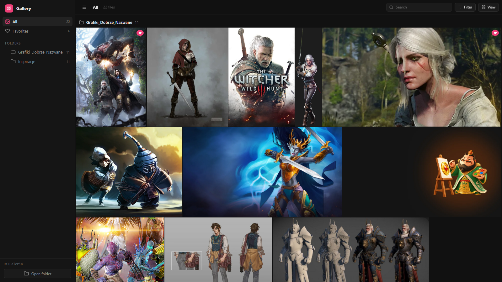

# local-gallery

**A fast, zero-dependency gallery for a folder of images and videos on your computer.**
One command opens any folder in the browser as a justified tile grid with
folders, a lightbox, favorites and live refresh. It's built for browsing piles
of AI-generated images and videos, and it works for any media folder.

```sh
npx local-gallery ~/Pictures/renders
```



## Features

- **Justified grid**: every row fills the width and each image keeps its
  proportions. Choose small, medium or large tiles.
- **Folders**: subfolders appear as a tree with counts. **All** shows every
  folder as its own section.
- **Lightbox**: arrow keys, click to zoom to full size, drag to pan, swipe on touch screens.
- **Favorites**: heart icon or the `F` key. Favorites are saved next to your files.
- **Multi-select**: Ctrl/Shift-click, then favorite or copy paths in bulk.
- **Hover actions**: download, copy the image to the clipboard, show in
  Explorer/Finder, copy the path or file name.
- **Filter and sort**: images, videos or favorites only. Sort by newest,
  oldest or name. Search by file name with `/`.
- **Live refresh**: new or deleted files show up within a second, with no reload.
- **Fast with big files**: WebP thumbnails are made once and cached.
- **Videos**: hover to preview, full player in the lightbox.
- **English and Polish** interface, picked from your browser language. Change it in **View**.
- **Private**: listens on `127.0.0.1` only and never changes your files.

Supported files: PNG, JPG, WebP, GIF, AVIF, BMP, SVG, MP4, WebM, MOV.

## Usage

Requires [Node.js](https://nodejs.org) 20 or newer.

```sh
npx local-gallery [folder] [options]
```

| Option | Description |
|---|---|
| `folder` | Folder to show. Default: the current folder. |
| `-p, --port <n>` | Preferred port. Default `8790`; the next free port is used if it's busy. |
| `--no-open` | Don't open the browser. |
| `--json` | Print one JSON line `{"url","root","port","reused"}` for scripts and agents. |
| `-v, --version` | Print the version. |
| `-h, --help` | Show help. |

Running it again for a folder that is already being served just opens the
existing gallery.

To install it permanently: `npm install -g local-gallery`, then run `local-gallery <folder>`.
To run it straight from GitHub: `npx github:MakowskiHubert/local-gallery <folder>`.

### Keyboard

| Key | Action |
|---|---|
| `/` | Search |
| `←` `→` | Previous / next in the lightbox |
| `F` | Toggle favorite in the lightbox |
| `Esc` | Leave zoom, close the lightbox, clear the selection |

## How it works

The server lists the folder, reads image sizes from file headers and serves
the files. The browser makes a WebP thumbnail the first time it shows a large
image. The thumbnail is cached on disk, so the grid loads quickly from then on.

The only thing written to disk is a hidden folder inside the gallery folder:

```text
<folder>/.local-gallery/
  thumbs/       cached thumbnails (safe to delete)
  state.json    { "favorites": ["Characters/hero.png", ...] }
```

Your images and videos are never modified, moved or deleted. The server
listens on `127.0.0.1`, rejects requests for other host names and cross-site
writes, and serves only media files inside the folder.

## For AI agents

local-gallery is a good place for an agent to put generated images and videos.
The user keeps the gallery open, and new files appear as soon as they're saved.

- **Skill**: [`skills/local-gallery/SKILL.md`](skills/local-gallery/SKILL.md)
  tells an agent how to start the gallery, where to save files and how to read
  the user's favorites. Install it with `npx skills add MakowskiHubert/local-gallery`,
  or copy the folder into your agent's skills directory
  (for example `.claude/skills/`).
- **Start from a script**: `npx local-gallery <folder> --no-open --json` prints
  the URL. If a gallery is already serving that folder, it is reused.
- **Read the library**: `GET /api/library` returns every file with its folder,
  size, dimensions and `favorite` flag.
- **User picks**: `<folder>/.local-gallery/state.json` lists the favorites.

### Use from Node.js

```js
import { startGallery } from 'local-gallery'

const gallery = await startGallery({ root: '/path/to/images', port: 8790 })
console.log(gallery.url)
await gallery.close()
```

## Development

```sh
git clone https://github.com/MakowskiHubert/local-gallery
cd local-gallery
npm test
npm start -- /path/to/images
```

There are no dependencies and no build step. See [AGENTS.md](AGENTS.md) for the
code layout and project rules.

## License

[MIT](LICENSE)
